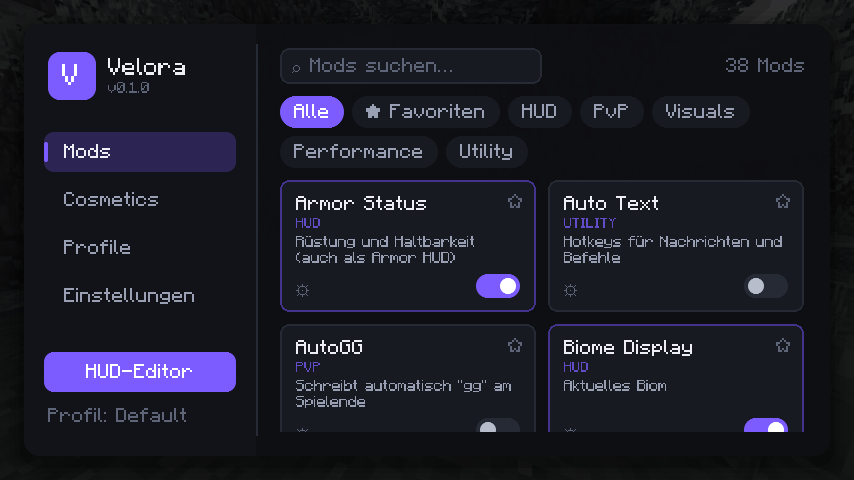
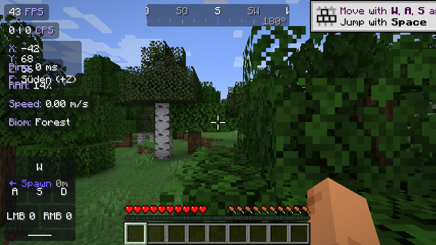
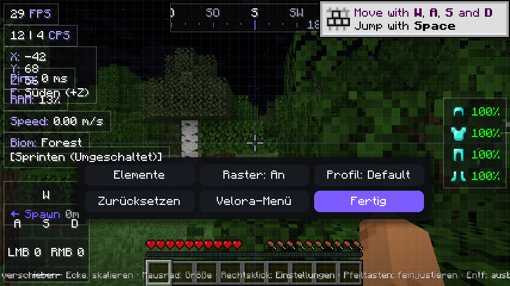
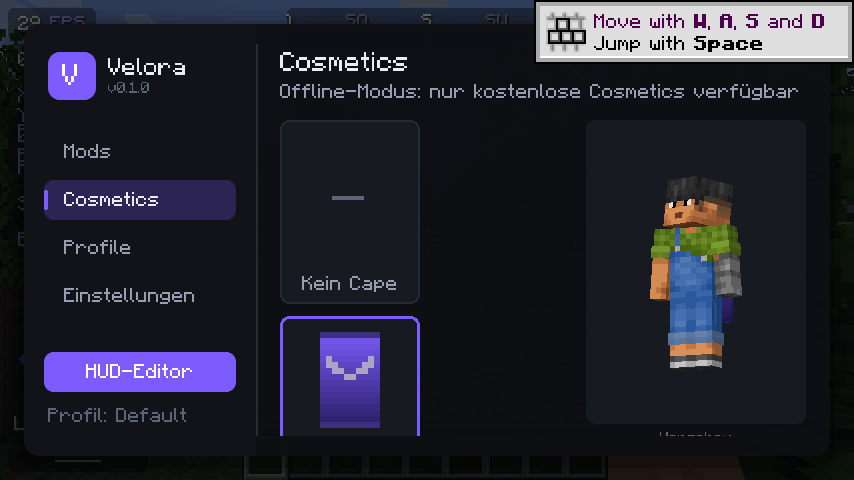

# Velora Client

> **Leicht, schnell, deins.** Ein eigenständiger Minecraft-Client (Fabric, **Minecraft 26.3** und **1.21.4**) mit eigenem
> Launcher, Mod-Menü, frei konfigurierbarem HUD-Editor, Profilen, Cosmetics und optionalem Backend.



| HUD im Spiel | HUD-Editor | Cosmetics |
|---|---|---|
|  |  |  |

*(Screenshots stammen aus dem automatisierten Selbsttest `gradlew :client-1.21.4:runSelftest`.)*

## Features (v0.1)

* **38 Mods** in 5 Kategorien – jeder mit Beschreibung, eigenen Einstellungen, Umschalt-Taste und Favoriten-Stern
  * **HUD:** FPS, CPS, Keystrokes, Armor Status, Potion Effects, Coordinates, Direction (Kompass), Ping, Memory,
    Speedometer, Biome, Clock, Scoreboard Customizer
  * **PvP:** Hit Color, Combo Counter, Reach Display (nur Anzeige), Crosshair Customizer, Toggle Sprint,
    Toggle Sneak, AutoGG, Perspective (Freelook), Zoom
  * **Visuals:** Fullbright, Time Changer, Weather Changer, Block Overlay, Nametags
  * **Performance:** FPS Optimizer, Entity Culling, Particle Optimizer, Render Distance Optimizer
  * **Utility:** Auto Text, Chat Customizer, Coordinates Clipboard, Server Information, Quick Join, Waypoints
    (`/waypoint`), Screenshot Manager
* **Mod-Menü** (Rechts-Shift): Suche, Kategorien, Favoriten, animierte Karten, Einstellungsseiten mit Schaltern,
  Slidern, HSB-Farbwähler (Alpha + Regenbogen), Tastenbelegung, Textfeldern
* **HUD-Editor:** Drag & Drop, Skalieren per Ecke oder Mausrad, Raster + Snap, Hilfslinien zu Bildschirmmitte und
  anderen Elementen, Pfeiltasten-Feinjustierung, Ein-/Ausblenden, Reset, Live-Vorschau mit Beispieldaten,
  HUD-Profile; Positionen sind anker-basiert und damit auflösungsunabhängig
* **Profile:** komplette Snapshots aller Mods, Einstellungen und HUD-Layouts; anlegen, duplizieren, löschen,
  exportieren, per Drag & Drop importieren, optional Cloud-Sync
* **Eigener Titelbildschirm** mit Quick Join
* **Cosmetics:** prozedural erzeugte Capes (keine fremden Assets), Freischaltung serverseitig geprüft
* **Launcher** (JavaFX): offizieller Microsoft-Login (Device Code, DPAPI-verschlüsselte Tokens, Besitzprüfung),
  Versionsauswahl pro Profil (26.3 / 1.21.4), automatische Installation von Minecraft + Fabric + Mods mit
  SHA-1-Prüfung, Java-Erkennung und Download der passenden Mojang-Java-Runtime (21 bzw. 25), RAM/JVM-Argumente/
  Auflösung pro Profil, Server-Shortcuts (Quick Play), Live-Logs, News, Updates mit SHA-256-Prüfung
* **Backend (optional):** News, Updates, Cosmetics-Besitz & -Ausrüstung, Config-Sync, anonyme Statistiken;
  Login per Mojang `hasJoined` – ohne Tokens an das Backend zu schicken

Details zur Architektur, Modul-Liste und Roadmap: [docs/ARCHITECTURE.md](docs/ARCHITECTURE.md)

## Projektstruktur

```
core/            versionsunabhängig: Module, Settings, Profile/Config, EventBus, HUD-Layout, Cosmetics, Backend-Client
client-26.3/     Fabric-Mod für Minecraft 26.3 (Mojang-Namen, SDL3-Eingabe, Java 25)
client-1.21.4/   Fabric-Mod für Minecraft 1.21.4 (Yarn, GLFW, Java 21) – gleiche Mods, eigene Plattform-Schicht
launcher/        JavaFX-Launcher (Auth, Installer, Java-Verwaltung, Start, UI)
backend/         optionaler HTTP-Server (JDK HttpServer)
docs/            Architektur, Installation, Microsoft-Login
```

## Bauen

Voraussetzung: **JDK 25** (Gradle/Loom und Minecraft 26.3) und **JDK 21** (1.21.4, Launcher). Gradle mit `JAVA_HOME` = JDK 25 starten; die Module wählen ihr JDK per Toolchain selbst.

```powershell
.\gradlew.bat release            # → dist/: Client-Mod, Launcher-Jar, Backend-Jar
.\gradlew.bat packageLauncher    # → dist/app/VeloraLauncher/VeloraLauncher.exe (inkl. Java-Runtime)
.\gradlew.bat :core:test         # Unit-Tests des Cores
```

## Entwickeln & Testen

```powershell
.\gradlew.bat :client-26.3:runClient      # Minecraft 26.3 mit Velora (1.21.4: :client-1.21.4:runClient)
.\gradlew.bat :client-26.3:runSelftest    # Mixin-Audit, alle Screens, Testwelt, Screenshots → client-26.3/run/screenshots
.\gradlew.bat :launcher:run                # Launcher-UI
java -jar dist\VeloraLauncher-0.1.0.jar --selftest   # End-to-End: Installation + Spielstart + Client-Selbsttest
.\gradlew.bat :backend:run                 # Backend auf Port 8787
```

## Sicherheit & Fairness

* Keine Passwörter, keine inoffiziellen Login-Workarounds – nur der offizielle Microsoft-OAuth-Flow.
* Tokens verschlüsselt (Windows DPAPI), nur an Microsoft/Xbox/Mojang übertragen.
* Alle PvP-Funktionen sind rein clientseitige Anzeigen/Komfortfunktionen. Reach Display misst nur, Toggle Sprint
  meldet lediglich die Taste als gedrückt – das Spiel entscheidet weiterhin selbst. Keine Hitbox-, Reach- oder
  Paket-Manipulation.

## Rechtliches

MIT-Lizenz (siehe [LICENSE](LICENSE)). Minecraft ist eine Marke von Mojang AB / Microsoft. Velora ist kein
offizielles Minecraft-Produkt und steht in keiner Verbindung zu Mojang oder Microsoft. Inspiriert vom
Funktionsumfang bekannter Clients – ohne deren Code, Logos oder Assets zu verwenden.
